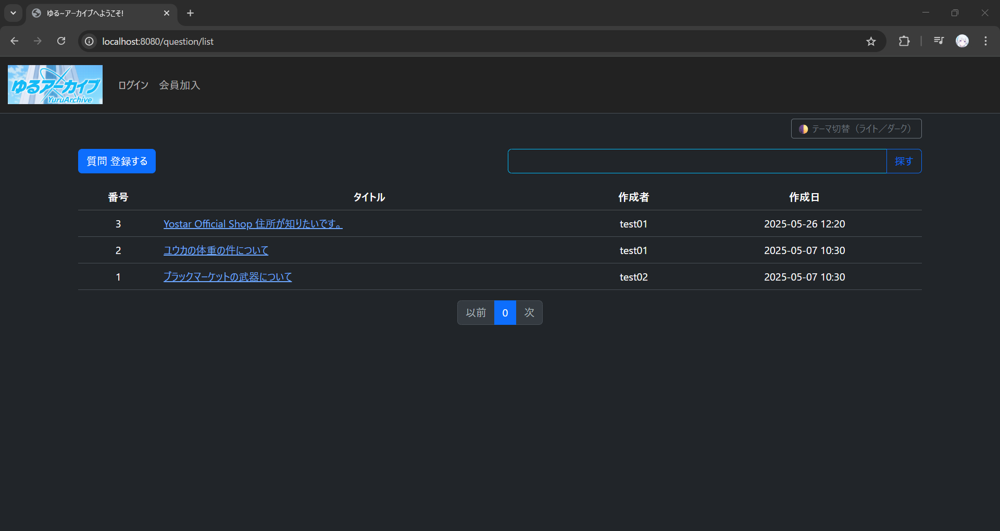
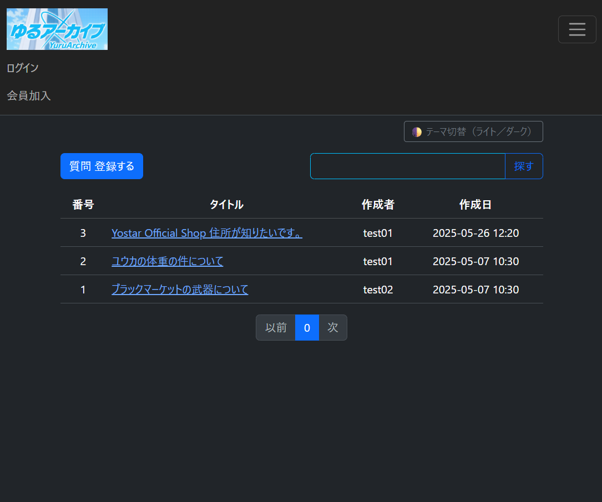

# yuru-archive（ゆるアーカイブ）


Spring Boot と PostgreSQL で作った、気軽に質問・回答できる Q&A 掲示板です。

## プロジェクトについて

ゆるアーカイブは、ある週末の夜、ふと「質問掲示板ってもっと気軽にできないかな」と思ったことから始まりました。
設計から実装・保守まで、すべて一人でこつこつ進めています。目指しているのは「ゆるく、でもちゃんと残る」アーカイブです。

プロジェクト名には、日頃楽しんでいるモバイルゲーム「ブルーアーカイブ」からのささやかなインスピレーションも込められています。

**「日常に、小さな奇跡を。」**  
その言葉のように、このプロジェクトが誰かの小さな気づきや発見につながればという気持ちで作っています。

## 画面

| PC | モバイル |
|---|---|
|  |  |

## 主な機能

| 分類 | 内容 |
|---|---|
| 会員 | 会員登録（郵便番号からの住所自動入力）、ログイン / ログアウト、会員情報の参照・編集、パスワード変更 |
| 質問 | 投稿・修正・削除、タイトル / 投稿者での検索、一覧での回答数表示 |
| 回答 | 投稿・修正・削除、回答への「いいね」 |
| 本文表示 | Markdown 表示、リンクカード（URL のタイトルと元ページへのリンクをカード表示） |
| 画像 | 質問への画像添付（JPG / PNG / GIF / WebP）、サムネイル生成、マウスオーバー拡大 |
| UI | ダークモード、PC / タブレット / モバイル対応 |

使い方の詳細は [利用者ガイド](doc/user/USER_GUIDE.md) を参照してください。

## 現在の状態

| 項目 | 内容 |
|---|---|
| アプリケーションバージョン | 0.1 |
| フェーズ | 保守・セキュリティ改善 / UI・UX 改善 |
| 基本機能の開発完了 | 2025年6月26日 |
| 直近の主な更新 | 2026年11月：コード点検に基づくセキュリティ修正、CI 試験導入、Gradle 9.8.2 へ更新 |

AI 機能は実装していません。Spring AI の依存関係は将来の検証用として残し、`spring.ai.model.chat=none` で自動構成を停止しています。

## 技術スタック

| 分類 | 使用技術 |
|---|---|
| 言語 / 実行環境 | Java 21（Temurin 21.0.13+9） |
| フレームワーク | Spring Boot 4.1.2（組み込み Tomcat 11.0.27）、Spring Security、Spring Data JPA |
| 画面 | Thymeleaf、Bootstrap 5.3 |
| データベース | PostgreSQL 16 |
| ビルド | Gradle 9.8.2（Gradle Wrapper） |
| 主なライブラリ | CommonMark、jsoup 1.23.2、Thumbnailator、Caffeine、Lombok 1.18.46 |
| 外部サービス | ZipCloud（郵便番号検索）、Microlink（リンクカード） |
| 実行・運用 | Docker / Docker Compose、GitHub Actions（CI）、Dependabot |

## クイックスタート

PostgreSQL とアップロード用フォルダを用意し、`src/main/resources/application.properties` の接続先とアップロード先を自分の環境に合わせてから起動します。

```bash
# Linux / macOS
./gradlew bootRun

# Windows
gradlew.bat bootRun
```

ブラウザで `http://localhost:8081` を開くと、質問一覧が表示されます。

Docker Compose での起動方法や設定項目の詳細は [開発環境の構築と起動](doc/dev/SETUP.md) を参照してください。

## ドキュメント

| 読む人 | ドキュメント |
|---|---|
| 掲示板を使う人 | [利用者ガイド](doc/user/USER_GUIDE.md) |
| 開発・保守する人 | [開発環境の構築と起動](doc/dev/SETUP.md) / [アーキテクチャ](doc/dev/ARCHITECTURE.md) / [セキュリティ設計](doc/dev/SECURITY.md) ほか |
| 経緯を知りたい人 | [変更履歴](doc/CHANGELOG.md) / [過去の開発記録](doc/history/README.md) |

すべての資料は [ドキュメント一覧](doc/README.md) から辿れます。

## License

This project is **NOT open source**.  
© 2025~2026 John Dev – All rights reserved.  
Commercial use without prior written permission is strictly prohibited.
