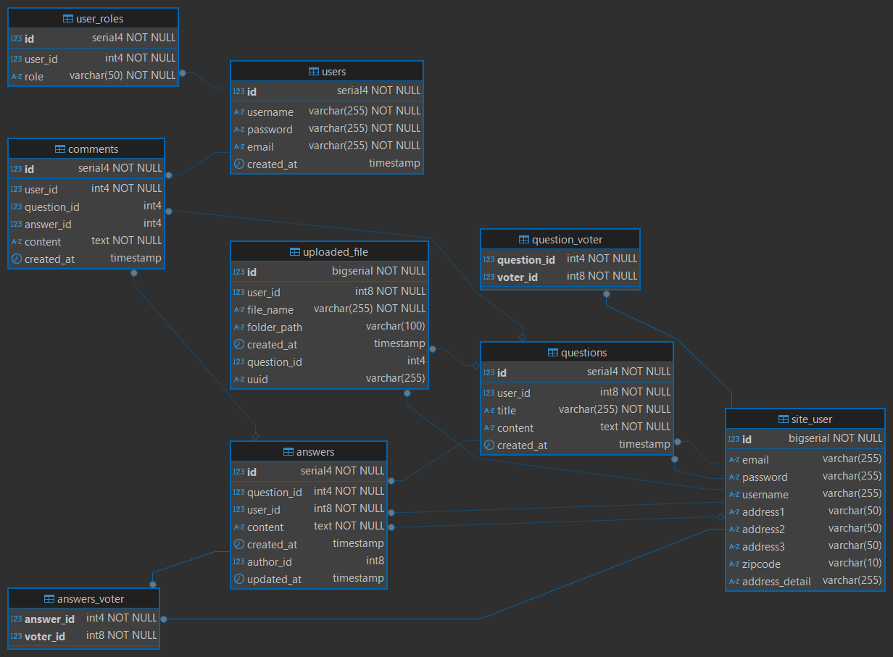

# DB・添付ファイル

データベースのテーブル構成と、添付ファイルの保存方法をまとめた資料です。

## 1. データベースの基本方針

- PostgreSQL を使用します（ローカルの DB 名は `yuru_archive_run`）。
- `spring.jpa.hibernate.ddl-auto=none` のため、アプリケーションはテーブルを作成・変更しません。
- 0.1 のリファクタリング以降、テーブル・カラム・外部キー・既存データは変更していません。スキーマを変更する場合は、別タスクとして計画します。

## 2. テーブル構成

エンティティとテーブルの対応です。カラム名は Spring Boot の命名規則（キャメルケース → スネークケース）で変換されます。

### `site_user`（会員）— `SiteUser`

| カラム | 型・制約 | 内容 |
|---|---|---|
| `id` | BIGINT、主キー（自動採番） | 会員 ID |
| `username` | 一意 | ユーザー ID |
| `password` | | BCrypt でハッシュ化したパスワード |
| `email` | 一意 | メールアドレス |
| `zipcode` | 10文字 | 郵便番号（ハイフンなしで保存） |
| `address1` / `address2` / `address3` | 各50文字 | 都道府県 / 市区町村 / 町名 |
| `address_detail` | 255文字 | 詳細住所 |

### `questions`（質問）— `Question`

| カラム | 内容 |
|---|---|
| `id` | 質問 ID（主キー） |
| `title` | タイトル（エンティティでは `subject`） |
| `content` | 本文（TEXT） |
| `created_at` | 作成日時 |
| `user_id` | 投稿者（`site_user.id`） |

### `answers`（回答）— `Answer`

| カラム | 内容 |
|---|---|
| `id` | 回答 ID（主キー） |
| `content` | 本文（TEXT） |
| `created_at` / `updated_at` | 作成日時 / 更新日時 |
| `question_id` | 対象の質問（`questions.id`） |
| `user_id` | 回答者（`site_user.id`、必須） |

### `answers_voter`（いいね）

| カラム | 内容 |
|---|---|
| `answer_id` | 回答（`answers.id`） |
| `voter_id` | いいねした会員（`site_user.id`） |

`(answer_id, voter_id)` の組み合わせで重複を防ぎます。

### `uploaded_file`（添付ファイル）— `UploadedFile`

| カラム | 内容 |
|---|---|
| `id` | ファイル ID（主キー） |
| `user_id` | アップロードした会員の ID |
| `file_name` | 元のファイル名（basename に正規化済み） |
| `uuid` | 保存ファイル名に付ける UUID |
| `folder_path` | 日付フォルダ（`yyyy/MM/dd`） |
| `created_at` | 登録日時 |
| `question_id` | 添付先の質問（`questions.id`） |

### 関係

```text
site_user 1 ── N questions 1 ── N answers
    │                │              │
    │                └── N uploaded_file
    └──────── N answers_voter N ────┘
```

ER 図（最新版）：



過去の版の ER 図は `assets/erd/` にあります。

## 3. SQL スクリプト

`sql/` のスクリプトは、作成時からの変更を時系列で記録したものです。新しい環境に適用するときは、[開発環境の構築と起動](SETUP.md#3-データベースの準備) の注意点を確認してください。

## 4. 添付ファイル

### 保存先

```properties
com.yuru.archive.upload.path=C:/Upload
```

保存時のファイル構成：

```text
{upload.path}/
  └─ 2026/11/17/
       ├─ {UUID}_{元のファイル名}      原本
       └─ s_{UUID}_{元のファイル名}    サムネイル
```

- `/upload/**` で配信します（`WebConfig`、キャッシュ1時間）。ログインなしで閲覧できます。
- Docker Compose では、コンテナの `/data/uploads` にホストのフォルダをマウントします。

### 受け付ける画像

| 確認内容 | 条件 |
|---|---|
| 拡張子 | `jpg` / `jpeg` / `png` / `gif` / `webp` |
| Content-Type | 拡張子と一致する画像の MIME タイプ |
| ファイルの中身 | JPEG / PNG / GIF / WebP のファイルシグネチャと一致すること。JPEG / PNG / GIF は実際にデコードできること |
| 画像の大きさ | 縦・横それぞれ8,000ピクセル以下、総ピクセル数4,000万以下（デコード前にヘッダーから確認） |
| ファイルサイズ | 1回のリクエストで合計10MBまで（`spring.servlet.multipart.*`） |

### 処理の担当

添付ファイルの処理は `AttachService` に集約しています。

| 処理 | 内容 |
|---|---|
| 保存 | 検証 → basename 化 → 日付フォルダ作成 → UUID 付きで保存 → 保存先の正規化と領域外チェック → サムネイル作成 → DB 登録 |
| 個別削除 | 質問の修正画面から。ファイル ID・質問 ID・会員 ID がすべて一致する場合だけ削除。全件の所有者確認が終わってから実ファイルを削除 |
| 質問ごとの削除 | 質問の削除時に、DB レコードと実ファイル（原本・サムネイル）を削除。実ファイルはトランザクションのコミット後に削除 |

- 回答には添付できません。回答の作成時にファイルが送られた場合は 400 を返します。
- 利用者からファイル名やパスを直接受け取るエンドポイントはありません（旧 `AttachController` は2026年9月に撤去）。
